# 🚀 Awesome AI-Powered Analytics Platform

<p align="center">
  
</p>

<p align="center">
  <a href="https://github.com/ishandutta2007/Awesome-Awesome-Awesome"></a><a href="https://discord.gg/jc4xtF58Ve"></a>
  <a href="https://github.com/ishandutta2007/Awesome-AI-Powered-Analytics-Platform/stargazers"></a>
  <a href="https://github.com/ishandutta2007/Awesome-AI-Powered-Analytics-Platform/blob/main/LICENSE"></a>
  <a href="https://github.com/ishandutta2007/Awesome-AI-Powered-Analytics-Platform/pulls"></a>
  <a href="https://github.com/ishandutta2007"></a>
</p>

---

## 📌 Overview & SEO Highlights

Welcome to the **Awesome AI-Powered Analytics Platform** ecosystem directory. This repository provides a comprehensive, research-backed index of premier **SaaS business intelligence suites** and **open-source analytics projects** transforming raw corporate data into actionable intelligence.

Move beyond static dashboards and manual SQL writing. These state-of-the-art platforms leverage **Large Language Models (LLMs)**, **autonomous data agents**, **Retrieval-Augmented Generation (RAG)**, and the **Model Context Protocol (MCP)** to deliver:
- 💬 **Natural Language Querying (NLQ) & Text-to-SQL**: Ask complex data questions in plain English and receive instant visualizations.
- 🔮 **Automated Insights & Root-Cause Explanations**: Discover why metrics fluctuate without manual slicing and dicing.
- 🤖 **Agentic Analytics Workflows**: Trigger operational actions directly from data anomalies using autonomous AI agents.
- 🔌 **Universal Semantic Layers & MCP Interoperability**: Seamlessly connect enterprise warehouses (Snowflake, BigQuery, ClickHouse, DuckDB) to frontier AI models (Claude, GPT, Gemini).

---

## 📑 Table of Contents

- [🌐 Sector Overview & Market Dynamics](#-sector-overview--market-dynamics)
- [🏢 SaaS & Hosted Analytics Platforms](#-saas--hosted-analytics-platforms)
- [🔓 Open-Source GitHub Projects](#-open-source-github-projects)
- [🏗️ Reference Architecture: Building Open AI Analytics](#️-reference-architecture-building-open-ai-analytics)
- [🤝 How to Contribute](#-how-to-contribute)
- [⭐ Star History](#-star-history)
- [⚖️ Disclaimer & Data Governance](#️-disclaimer--data-governance)

---

## 🌐 Sector Overview & Market Dynamics

- 📊 **Estimated Market Size**: The global AI-powered analytics and business intelligence software market is valued at approximately **$18.5 Billion in 2026** and is projected to expand to **$56.2 Billion by 2032**, demonstrating an aggressive Compound Annual Growth Rate (CAGR) of **~26.8%**.
- 🧩 **Market Concentration & Dynamics**: The sector is **moderately fragmented**. Mega-cap hyperscalers (Microsoft and Salesforce) anchor traditional enterprise business intelligence with dominant office ecosystem distribution; however, the market strongly resists a "winner-take-all" outcome. A dynamic tier of agile AI-native challengers (ThoughtSpot, Sisense, Julius AI, Akkio) and composable open-source frameworks (Apache Superset, Metabase, Wren AI, MindsDB) are rapidly capturing market share through autonomous reasoning agents, multi-cloud flexibility, and open Model Context Protocol (MCP) data architectures.

---

## 🏢 SaaS & Hosted Analytics Platforms

The following enterprise platforms provide managed, cloud-native conversational analytics and AI copilot services. Entries are sorted descending by company scale (**Market Capitalization / Valuation / Revenue**).

| 🏢 Platform / Product | 📈 Company Size (Valuation / Revenue) | 💳 Starting Price | 🎁 Free Tier / Trial Limits | ⚡ Key AI & Analytics Capabilities |
| :--- | :--- | :--- | :--- | :--- |
| **[Power BI Copilot](https://powerbi.microsoft.com/)** | **~$3.1 Trillion** Market Cap<br>*(FY24 Rev: $245B+)* | **$14/user/mo** (Power BI Pro) + Microsoft Fabric capacity from **$0.36/hr** (~$262.80/mo pay-as-you-go for F2 SKU) | **Free Forever**: Power BI Desktop (free local report authoring & data modeling for 1 user, no cloud sharing).<br>**60-Day Trial**: Microsoft Fabric capacity trial (1 TB OneLake; note: Copilot usage requires paid F-SKU capacity). | Full-screen Copilot chat in Fabric, natural language DAX formula generation, automated narrative visual generation, remote MCP server for Entra ID data chat. |
| **[Tableau Pulse](https://www.tableau.com/products/tableau-pulse)** | **~$280 Billion** Market Cap<br>*(FY24 Rev: $34.9B)* | Included in Tableau Cloud Creator at **$75/user/mo** (*$70/mo billed annually*; Viewer at $15/mo) | **Free Forever**: Tableau Public (free authoring & sharing of public workbooks, no Pulse).<br>**14-Day Trial**: Tableau Cloud free trial (includes Pulse, web authoring & Prep).<br>**60-Day Trial**: Tableau Agent in Pulse trial for active sites. | Automated personalized metric digests pushed to Slack/Teams/Email, natural language metric Q&A via Tableau Agent, correlated metric discovery, Agentforce Trust Layer governance. |
| **[ThoughtSpot](https://www.thoughtspot.com/)** | **~$4.5 Billion** Valuation<br>*(Unicorn, $150M+ ARR)* | **$25/user/mo** billed annually (Essentials tier, min. 5 users: ~$125/mo) or **$95/mo** consumption base | **14-Day Free Trial**: Complete access to cloud analytics, interactive Liveboards, Spotter AI agent, up to 25 million rows of data, no credit card required. | Spotter 3 conversational agent blending structured and unstructured datasets, acts as MCP host for Slack & Salesforce, embeddable analytics via SDK/APIs. |
| **[Sisense](https://www.sisense.com/)** | **~$1.6 Billion** Valuation<br>*(Unicorn, $140M+ ARR)* | Starting at **~$833/mo** (*$10,000/year billed annually*, custom enterprise contract based on data volume & seats) | **14-Day Free Trial**: Hands-on evaluation of Sisense Compose SDK, warehouse connectors, dashboards, and sandbox data for up to 5 user seats. | Sisense Intelligence assistant for natural language dashboard and data model creation, MCP server for ChatGPT/Claude integration, Managed LLM service, ISO 27701 compliant. |
| **[Domo (Domo AI)](https://www.domo.com/)** | **~$380 Million** Market Cap<br>*(FY24 Rev: $319M)* | Starting at **~$910/mo** (*$10,920/year billed annually*, consumption credit-based contract) | **30-Day Free Trial**: Full access to cloud data integration, interactive dashboards, Domo AI Chat, App Catalyst, and standard AI models with unlimited users. | DomoGPT conversational analytics, AI Toolkits packaging workflows into reusable blocks, central AI Library for agent governance, MCP server for automated card creation. |
| **[Databox](https://databox.com/)** | **~$120 Million** Est. Valuation<br>*(Private, $25M+ ARR)* | **$71/mo** billed annually (*$90/mo billed monthly*) for Starter/Analyst plan | **Free Forever Plan**: 1 user, 3 fixed data source connections, 1 dashboard, 10 custom metrics, daily data sync, 11 months historical data, 50 AI credits/mo.<br>**14-Day Trial**: All paid features. | Genie AI analyst for plain-language KPI queries across 130+ integrations, automated AI Performance Summaries explaining metric changes, MCP integration for Claude/ChatGPT/n8n. |
| **[Julius AI](https://julius.ai/)** | **~$60 Million** Est. Valuation<br>*(Fast-growth, ~$15M ARR)* | **$20/mo** (*$16/mo billed annually*) for Plus plan; $45/mo for Pro | **Free Forever Plan**: 25-credit one-time welcome bonus + 25 daily refresh credits (basic models, ~15-20 queries/month, light notebook analysis). | AI data science workspace, multi-file analysis (CSV, Excel, PDF), automatic Python/R code execution, interactive charts, live connectors to PostgreSQL, Snowflake, BigQuery. |
| **[Akkio](https://www.akkio.com/)** | **~$40 Million** Est. Valuation<br>*($17.5M Funding Raised)* | **$49/mo** for Starter plan; $99/mo for Professional | **14-Day Free Trial**: Complete access to generative Chat Engine, automated campaign reports, predictive ML models, datasets up to 1M rows, no credit card required. | Purpose-built AI analytics for media and marketing teams, RAG-based multi-table reasoning, live web strategy agents, predictive forecasting. |
| **[Polymer Search](https://polymersearch.com/)** | **~$15 Million** Est. Valuation<br>*($5M+ Funding Raised)* | **$20/mo** (*$10/mo billed annually*) for Starter plan; $50/mo for Pro | **7-Day Free Trial**: Full dashboard builder, PolymerAI natural language search, Google Sheets/CSV sync, up to 100,000 spreadsheet cells; free student/educator tier. | Automated spreadsheet-to-interactive-dashboard transformation, PolymerAI natural language data exploration, instant visualization suggestions, zero-code shareable web apps. |

---

## 🔓 Open-Source GitHub Projects

Explore the top open-source projects for self-hosting, Text-to-SQL agents, semantic layers, and conversational business intelligence. Repositories are strictly sorted descending by **GitHub Star Count**.

- **[Grafana](https://github.com/grafana/grafana)** [](https://github.com/grafana/grafana/stargazers)  
  *License: AGPL-3.0* | Leading open-source operational analytics, monitoring, and interactive visualization platform with AI/LLM dashboard assistants, natural language query generation, and 150+ data connectors.

- **[Apache Superset](https://github.com/apache/superset)** [](https://github.com/apache/superset/stargazers)  
  *License: Apache-2.0* | Enterprise-grade modern data exploration and business intelligence web application featuring a rich no-code chart builder, SQL IDE, seamless LLM/text-to-SQL extensions, and 40+ database connectors.

- **[Metabase](https://github.com/metabase/metabase)** [](https://github.com/metabase/metabase/stargazers)  
  *License: AGPL-3.0* | The simplest, fastest open-source BI and self-service analytics tool. Offers visual Query Builder for non-technical users, Metabot AI natural language querying, and instant single-container deployment.

- **[MindsDB](https://github.com/mindsdb/mindsdb)** [](https://github.com/mindsdb/mindsdb/stargazers)  
  *License: GPL-3.0* | AI platform that connects enterprise databases directly to AI/LLM models, allowing developers to query structured and unstructured data with natural language, build conversational AI agents, and trigger predictive automations.

- **[Redash](https://github.com/getredash/redash)** [](https://github.com/getredash/redash/stargazers)  
  *License: BSD-2-Clause* | Popular open-source BI platform designed to enable teams to query, visualize, and collaborate on data with built-in SQL editor, automated alert triggers, and REST APIs for AI copilot integrations.

- **[DataEase](https://github.com/dataease/dataease)** [](https://github.com/dataease/dataease/stargazers)  
  *License: GPL-3.0* | Open-source data visualization analysis tool that helps users quickly analyze data and gain business insights through an intuitive drag-and-drop dashboard interface with AI copilot capabilities.

- **[PandasAI](https://github.com/Sinaptik-AI/pandas-ai)** [](https://github.com/Sinaptik-AI/pandas-ai/stargazers)  
  *License: MIT* | Conversational AI platform and Python library that empowers users to talk to their dataframes and SQL databases in natural language, generating plots, statistical summaries, and pipeline insights automatically.

- **[Vanna](https://github.com/vanna-ai/vanna)** [](https://github.com/vanna-ai/vanna/stargazers)  
  *License: MIT* | Highly accurate open-source Python-based RAG (Retrieval-Augmented Generation) framework for Text-to-SQL generation. Trains on DDL, documentation, and SQL queries to deliver hallucination-free database answers.

- **[Cube.js](https://github.com/cube-js/cube)** [](https://github.com/cube-js/cube/stargazers)  
  *License: Apache-2.0* | Universal open-source semantic layer for AI agents and headless BI. Provides centralized data modeling, pre-aggregations, access control, and dynamic SQL generation for LLMs.

- **[Wren AI](https://github.com/Canner/WrenAI)** [](https://github.com/Canner/WrenAI/stargazers)  
  *License: Apache-2.0* | Open-source SQL AI Agent designed for data teams. Bridges natural language questions with relational databases via an intelligent semantic engine, automated schema discovery, and hallucination guardrails.

- **[Evidence](https://github.com/evidence-dev/evidence)** [](https://github.com/evidence-dev/evidence/stargazers)  
  *License: MIT* | Code-driven Business Intelligence tool that combines markdown, SQL, and reactive visualization components into version-controlled, lightning-fast, and reproducible data reports.

- **[Lightdash](https://github.com/lightdash/lightdash)** [](https://github.com/lightdash/lightdash/stargazers)  
  *License: MIT* | Open-source BI platform natively coupled with dbt (data build tool). Treats dbt as the definitive semantic layer, enabling self-serve AI analytics without duplicating metric definitions.

- **[RATH](https://github.com/Kanaries/Rath)** [](https://github.com/Kanaries/Rath/stargazers)  
  *License: AGPL-3.0* | Next-generation augmented analytics and automated exploratory data analysis (EDA) platform with autonomous causal discovery and generative AI data visualization.

- **[Knowage](https://github.com/KnowageLabs/Knowage-Server)** [](https://github.com/KnowageLabs/Knowage-Server/stargazers)  
  *License: AGPL-3.0* | Comprehensive enterprise open-source business intelligence suite combining traditional reporting, cockpit dashboards, predictive models, and self-service analytics.

- **[Zaturn](https://github.com/kdqed/zaturn)** [](https://github.com/kdqed/zaturn/stargazers)  
  *License: MIT* | Open-source AI-powered data analyst running as a Model Context Protocol (MCP) server for Claude and Cursor. Connects to SQLite, PostgreSQL, DuckDB, MySQL, and Parquet files with zero external data exfiltration.

- **[Orion Data Analyst](https://github.com/gavrielhan/orion-data-analyst)** [](https://github.com/gavrielhan/orion-data-analyst/stargazers)  
  *License: MIT* | Autonomous AI data analyst agent powered by Google Gemini and LangGraph. Connects to BigQuery, performs self-healing SQL retries, automated RFM segmentation, and safety validation (blocks DROP/DELETE).

---

## 🏗️ Reference Architecture: Building Open AI Analytics

For engineering and data teams seeking zero vendor lock-in, combine these open-source layers to assemble a production-grade enterprise stack:

```
┌────────────────────────────────────────────────────────┐
│             Conversational Interface Layer             │
│    (Claude Desktop / Cursor / Chat UI via MCP)         │
└──────────────────────────┬─────────────────────────────┘
                           │
┌──────────────────────────▼─────────────────────────────┐
│             Autonomous AI Analyst Agent                │
│       (Wren AI / Vanna / PandasAI / Zaturn MCP)        │
└──────────────────────────┬─────────────────────────────┘
                           │
┌──────────────────────────▼─────────────────────────────┐
│           Semantic Modeling & Governance Layer         │
│               (Cube.js / Lightdash / dbt)              │
└──────────────────────────┬─────────────────────────────┘
                           │
┌──────────────────────────▼─────────────────────────────┐
│             High-Performance Query Engines             │
│       (ClickHouse / DuckDB / PostgreSQL / Trino)       │
└──────────────────────────┬─────────────────────────────┘
                           │
┌──────────────────────────▼─────────────────────────────┐
│             Interactive Dashboard Presentation         │
│            (Apache Superset / Metabase / Grafana)      │
└────────────────────────────────────────────────────────┘
```

---

## 🤝 How to Contribute

Contributions are warmly welcomed! Help make this the most up-to-date and authoritative guide to AI-powered analytics.

1. 🍴 Fork the repository.
2. 🌿 Create a descriptive branch: `git checkout -b add-tool-name`.
3. 📝 Add or update an entry in [`README.md`](file:///C:/Users/ishan/Documents/Projects/Awesome-AI-Powered-Analytics-Platform/README.md) following the existing tabular or open-source list format (include specific pricing, free tier limits, star badges, and links).
4. 🚀 Submit a Pull Request with a short summary of the product or project.

---

## ⭐ Star History

[](https://star-history.dera.page/#ishandutta2007/Awesome-AI-Powered-Analytics-Platform&type=date&legend=top-left)

---

## ⚖️ Disclaimer & Data Governance

- ℹ️ This repository is a community-curated directory intended for research, evaluation, and educational purposes.
- 🔒 AI-powered analytics solutions handling organizational data must comply with enterprise data protection regulations (GDPR, CCPA, HIPAA, SOC 2).
- 🛡️ Self-hosted open-source models and MCP servers require rigorous query validation guardrails. While LLM capabilities continue to advance, human validation of mission-critical financial and operational metrics is strongly advised.

---

<p align="center">
  <b>Built with ❤️ for data engineers, analysts, product builders, and developers shaping the future of AI analytics.</b><br>
  Explore more curated lists on <a href="https://github.com/ishandutta2007/Awesome-Awesome-Awesome">Awesome-Awesome-Awesome</a>.
</p>
